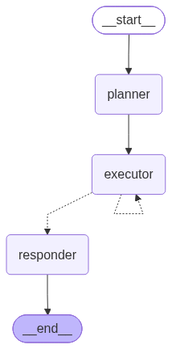
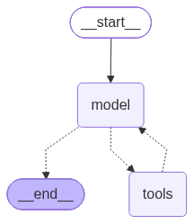

# Agent graphs

The two LangGraph graphs from `src/hiring_agent/app/agent.py`, rendered with
`get_graph().draw_mermaid_png()`. Solid arrows are fixed edges; dotted arrows are
conditional edges.

## Main agent graph

planner runs once, executor repeats once per plan step, responder writes the final answer.

## Executor sub-agent graph

The `create_agent` ReAct loop that runs inside ONE executor visit: model decides, tools
run, and the loop ends when the model makes no tool call.

## Guarded data flow (HTML diagrams)

Two dark-theme diagrams of the guardrails, made with the diagram-design skill. Open them in a browser.

- [`agent_dataflow_overview.html`](agent_dataflow_overview.html): the whole graph as a data flow. Lanes are
  guard nodes, LLM nodes and tool calls; columns are the six run steps; chips show what data
  goes in and out of each node.
- [`guardrail_layers.html`](guardrail_layers.html): the guard layers L1 to L4b. For each layer: where it is
  enforced, when it runs, what it checks (with thresholds), who decides and what happens on fail.
